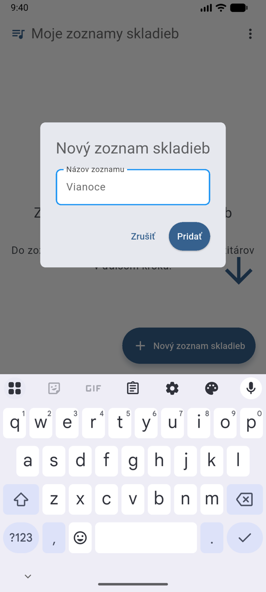
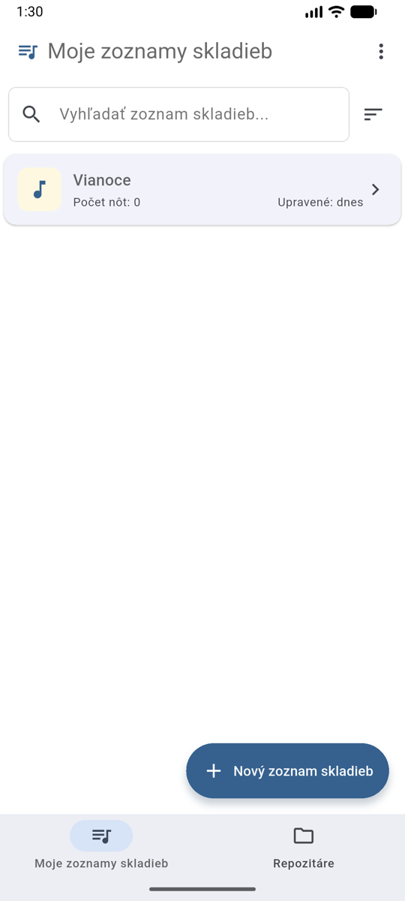
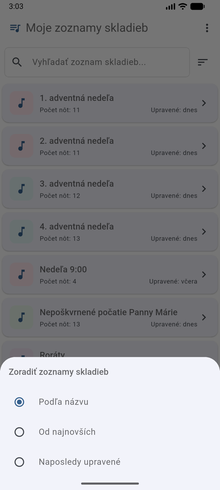
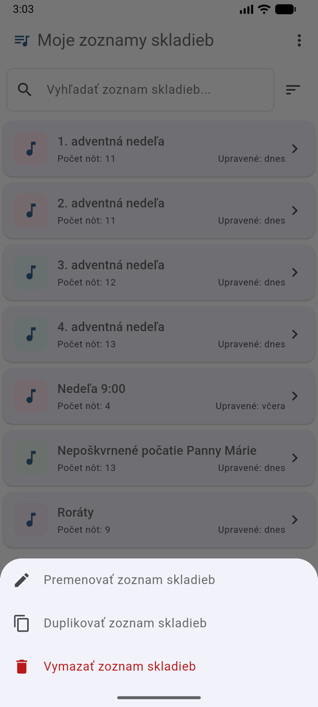
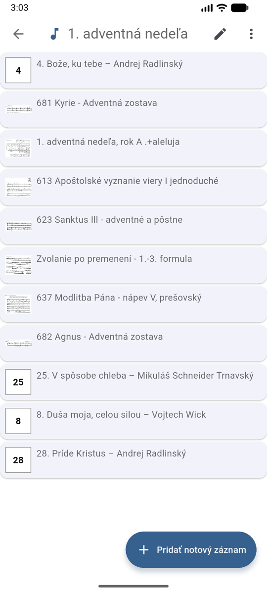

# Zoznamy skladieb

Zoznam skladieb je vaša príprava na konkrétnu príležitosť — svätú omšu, sobáš, pohreb či koncert.
Noty v ňom máte v poradí, v akom ich budete hrať, a počas hrania medzi nimi len listujete.

Obrazovka **Moje zoznamy skladieb** je domovská obrazovka aplikácie.

## Vytvorenie zoznamu

1. Na obrazovke **Moje zoznamy skladieb** ťuknite na tlačidlo **+ Nový zoznam skladieb**.
2. Zadajte názov (napr. *Vianoce*, *Sobáš 14. 9.*) a ťuknite na **Pridať**.

{ width="300" }
{ width="300" }

Pri každom zozname vidíte počet nôt, ktoré obsahuje, a vpravo dole dátum poslednej úpravy (**Upravené**).
Pri zoradení **Od najnovších** sa namiesto neho zobrazuje dátum vytvorenia (**Vytvorené**).

## Vyhľadávanie a zoradenie zoznamov

Keď máte zoznamov viac, nad nimi je pole **Vyhľadať zoznam skladieb...** — stačí napísať časť názvu.
Na diakritike ani veľkých písmenách nezáleží, *svadba* nájde aj *Svadba Žilina*. Ak sa nič nenájde, zobrazí
sa hláška **Nenašli sa žiadne zoznamy skladieb**.

Ikona **zoradenia** vpravo od vyhľadávania ponúka dve možnosti:

- **Podľa názvu** — predvolené abecedné poradie.
- **Od najnovších** — naposledy vytvorený (alebo duplikovaný) zoznam je hore.
- **Naposledy upravené** — hore je zoznam, v ktorom ste naposledy niečo menili (názov, noty, ich poradie
  či transpozíciu). Zoznamy, ktoré ste od aktualizácie ešte neupravovali, sa radia podľa dátumu vytvorenia.

{ width="300" }

## Premenovanie, duplikovanie a vymazanie zoznamu

Dlho podržte prst na zozname — zobrazí sa ponuka s troma možnosťami:

{ width="300" }

- **Premenovať zoznam skladieb** — zadajte nový názov a ťuknite na **Premenovať**.
- **Duplikovať zoznam skladieb** — vytvorí kópiu zoznamu so všetkými notami v rovnakom poradí.
  Aplikácia navrhne názov *pôvodný názov (kópia)*, ktorý môžete pred ťuknutím na **Duplikovať** zmeniť —
  len nie na rovnaký názov, aký má pôvodný zoznam.
  Hodí sa, keď hráte podobnú omšu opakovane a chcete si pripraviť variant bez toho, aby ste pôvodný zoznam menili.
- **Vymazať zoznam skladieb** — potvrďte vymazanie. *Táto akcia sa nedá vrátiť späť.*

Ak sa vytvorenie, premenovanie, duplikovanie alebo vymazanie zoznamu nepodarí uložiť, aplikácia zobrazí hlášku
**Nastala chyba** — zoznamy zostanú v pôvodnom stave a akciu môžete zopakovať.

<video autoplay loop muted playsinline controls width="300">
  <source src="../assets/videos/playlist-menu.mp4" type="video/mp4">
</video>

## Práca s notami v zozname

Ťuknutím zoznam otvoríte. Noty pridáte tlačidlom **+ Pridať notový záznam** —
podrobne v kapitole [Pridávanie nôt](adding-music-sheets.md).

{ width="300" }

### Zmena poradia

Dlho podržte prst na note a potiahnite ju na nové miesto:

<video autoplay loop muted playsinline controls width="300">
  <source src="../assets/videos/reordering-sheets.mp4" type="video/mp4">
</video>

### Premenovanie a vymazanie noty

Ťuknite na **ceruzku** vpravo hore — zoznam sa prepne do režimu úprav a pri každej note
sa zobrazia ikony na **premenovanie** (ceruzka) a **vymazanie** (kôš). Premenovanie noty
v zozname nemení notu v repozitári — každý si ju môže nazvať po svojom.

!!! tip
    Vymazaním noty zo zoznamu ju odstránite len z tohto zoznamu — v repozitári zostáva ďalej dostupná.
